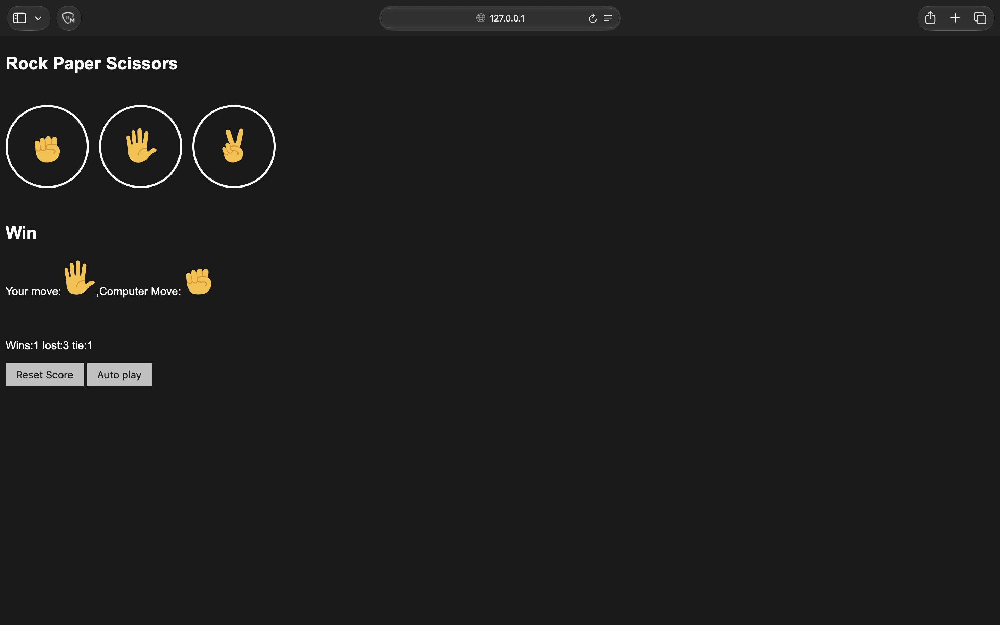
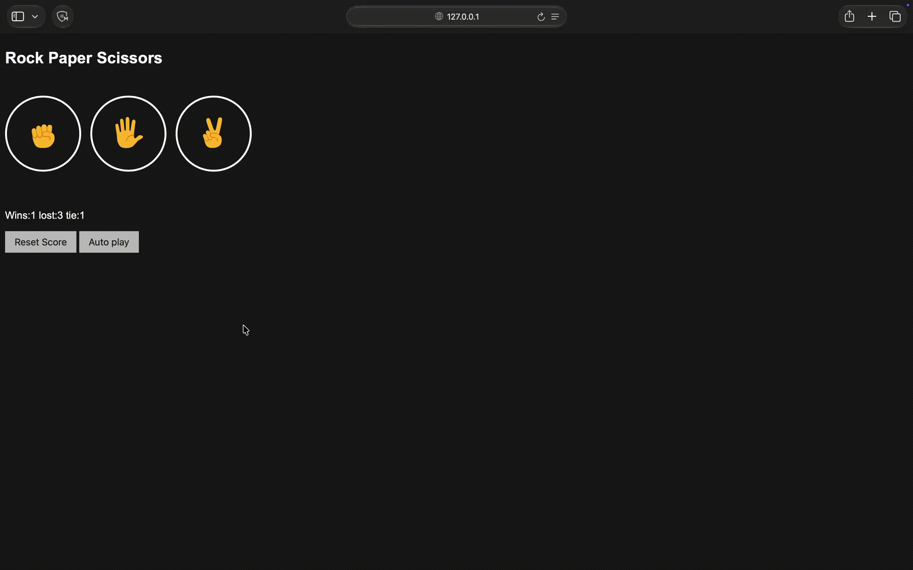

# Rock Paper Scissors Game

A simple interactive Rock Paper Scissors game built using HTML, CSS, and JavaScript. Play against the computer, track your score, and use Auto Play to run the game automatically.

## Features

- **Interactive Gameplay:** Choose Rock, Paper, or Scissors to play against the computer.
- **Random Computer Moves:** Computer generates a random move for every round.
- **Score Tracking:** Tracks wins, losses, and ties.
- **Persistent Score:** Saves the score in browser Local Storage, so it remains after refreshing the page.
- **Reset Score:** Reset all scores whenever you want.
- **Auto Play:** Automatically plays a round every second.

## Technologies Used

- HTML5
- CSS3
- JavaScript
- DOM Manipulation
- Browser Local Storage

## Project Structure

```text
rock-paper-scissor/
├── images/
├── screenshots/
│   ├── autoplay.mov
│   └── rock-paper-scissor.png
├── rock-paper-scissor.css
├── rock-paper-scissor.html
├── rock-paper-scissor.js
└── README.md
```

## Screenshots

### Game Interface


## Gameplay Demo



## How to Run

1. Clone this repository:

   ```bash
   git clone https://github.com/ChDeepak126/rock-paper-scissor.git
   ```

2. Open the project folder.
3. Open `rock-paper-scissor.html` in your browser, or use the Live Server extension in VS Code.
4. Start playing!

## Game Rules

- Rock beats Scissors.
- Scissors beats Paper.
- Paper beats Rock.
- If both players choose the same move, the round is a tie.

## Concepts Practiced

- JavaScript functions and conditional statements
- `Math.random()` for random move generation
- DOM manipulation using `querySelector()` and `innerHTML`
- Event handling
- `setInterval()` and `clearInterval()`
- Browser Local Storage
- JSON data handling

## Author

**Deepak Chillarige**

GitHub: [ChDeepak126](https://github.com/ChDeepak126)